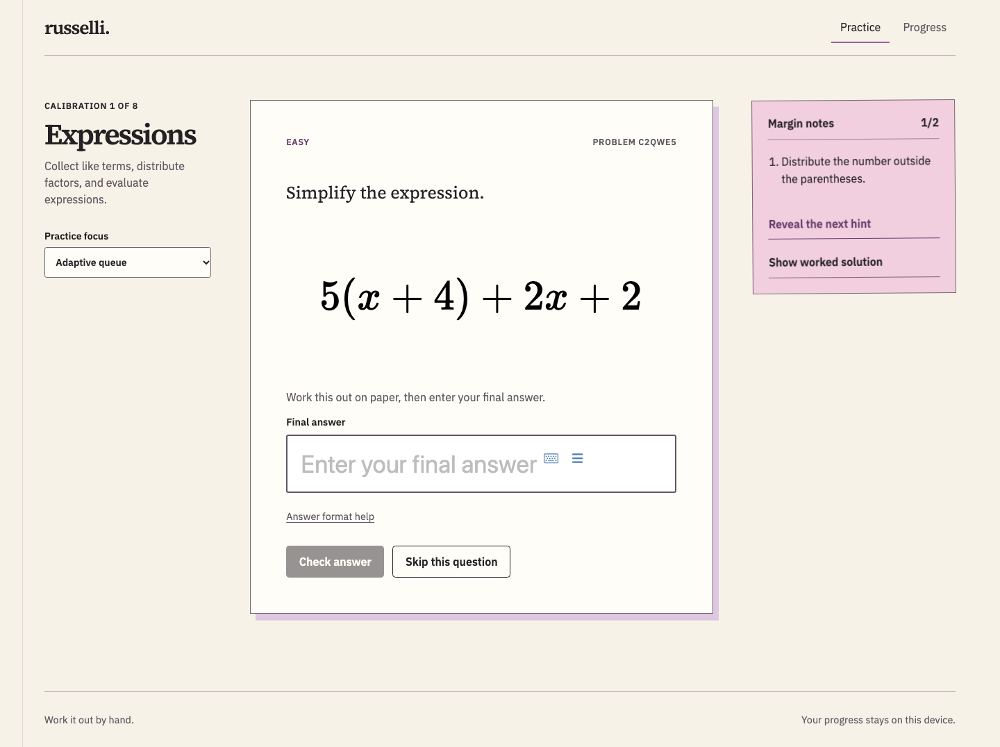
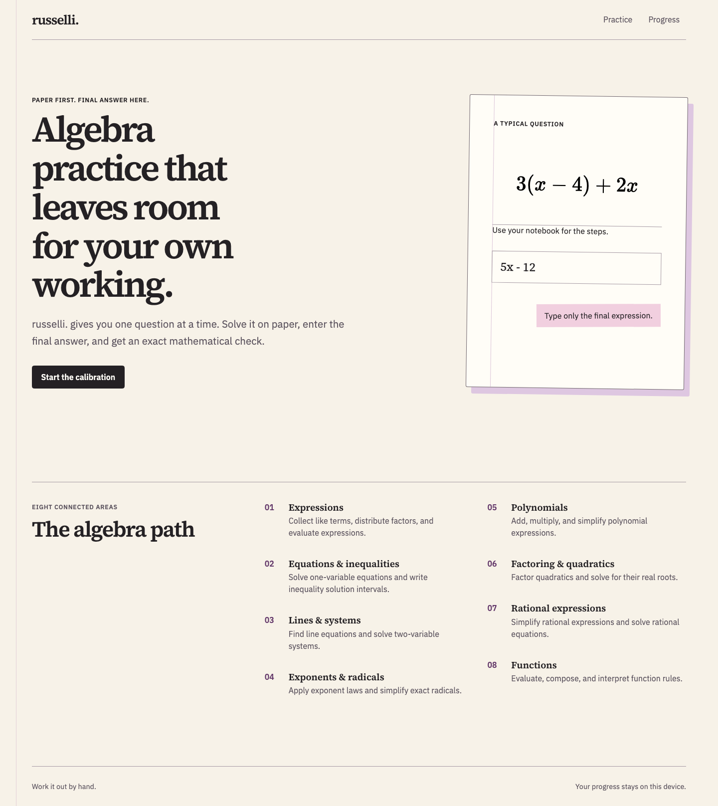
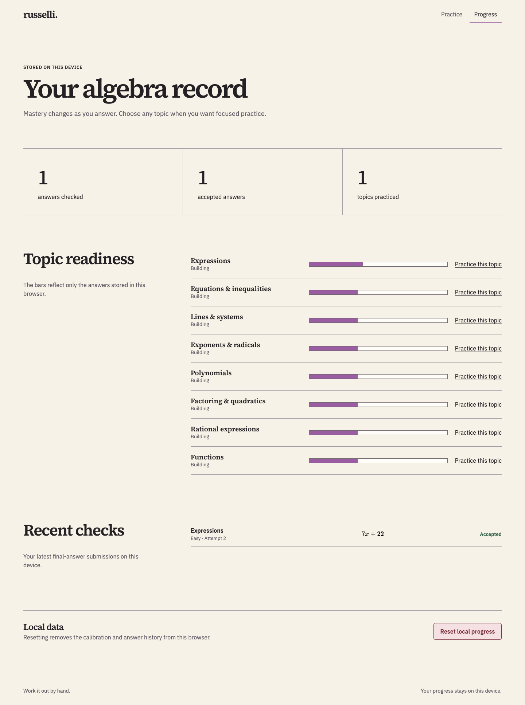
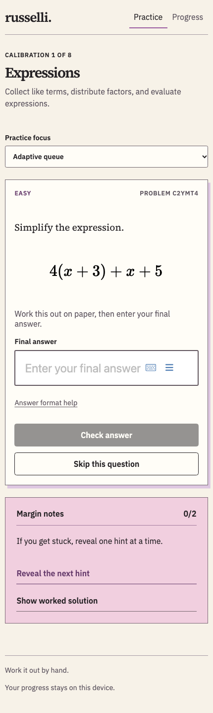

# russelli.

Paper-first algebra practice for college beginners. The site presents one problem at a time: work through it in a notebook, enter the final mathematical answer, and check it in the browser.

Live site: [hafiz122.github.io/russelli](https://hafiz122.github.io/russelli/)

## Screenshots

Captured from the live site on 5 November 2026.

The practice screen keeps the problem, final-answer field, and hints together.



<details>
<summary>Home page</summary>



</details>

<details>
<summary>Progress page</summary>

This record shows one accepted answer submitted during the screenshot session.



</details>

<details>
<summary>Mobile practice</summary>



</details>

## Using the site

1. Open **Practice** to start or resume the eight-topic calibration.
2. Solve the displayed problem on paper. Use the math field and its virtual keyboard to enter your final answer.
3. Select **Check answer** or press Enter. Incomplete input keeps the check button disabled; an incorrect answer can be edited and checked again.
4. Reveal hints one at a time or open the worked solution when you need help. You can also skip a question.
5. Continue with the adaptive queue, or select a topic under **Practice focus** for focused practice.
6. Open **Progress** to review topic readiness and recent answer checks. **Reset local progress** opens a confirmation dialog before clearing the record.

The adaptive queue considers mastery, how recently a topic appeared, and prerequisite readiness. Difficulty moves between easy, medium, and hard as mastery changes. First-attempt success increases mastery more than success after retries or hints; incorrect checks and skips reduce it.

### Points and streaks

Each accepted answer earns **10 points** and adds one to your correct-answer streak. Every fifth answer in a streak earns **10 extra points**: a streak of five earns 60 points in total, and a streak of ten earns 120. Calibration and adaptive practice use the same rules at every difficulty.

A mistake or skip resets the current streak, while your points and best streak remain. A correct retry earns points and starts a new streak. Hints do not affect rewards. Showing the worked solution before acceptance resets the streak and makes that question ineligible for points or streak advancement; viewing it after acceptance changes nothing. Incomplete input has no effect, and repeated submissions cannot award the same question twice.

Practice shows your points and current streak beside the problem. Progress also shows your best streak. Open **How points work** on either page for the rules. Streaks persist across visits and topic changes, with no daily deadline. A displayed problem and its difficulty stay fixed until you load or skip to the next question.

### Topics and answer formats

| Topic | Current practice |
| --- | --- |
| Expressions | Distribute factors and collect like terms |
| Equations & inequalities | Solve linear equations and express inequality solutions as intervals |
| Lines & systems | Find a line through two points and solve two-variable linear systems |
| Exponents & radicals | Multiply powers with the same base and simplify square roots |
| Polynomials | Expand and simplify products of binomials |
| Factoring & quadratics | Factor quadratics and find their real roots |
| Rational expressions | Cancel common factors and solve rational equations |
| Functions | Evaluate compositions and inverse functions |

Follow each problem's answer instructions:

- Enter numbers, fractions, expressions, or equations as requested. The validator compares mathematical equivalence rather than literal text.
- Enter system solutions as `(x, y)` and quadratic roots as `(smaller, larger)`.
- Use interval notation for inequalities, such as `[2, ∞)`. Infinity always takes a parenthesis. The validator also supports equivalent one-sided inequality notation.
- Keep a factorization in factored form when the question requests it, and cancel common factors when simplifying a rational expression. Equivalence alone does not satisfy these form requirements.

### Local progress

The application runs entirely in the browser, with no account or backend service. It saves calibration state, mastery scores, topic preference, recent attempts, recent seeds, cumulative points, current and best streaks, and the current question's reward status in `localStorage` under `russelli.progress.v1`. Older records retain their learning history and start with zero rewards; historical answers do not receive points retroactively. Invalid reward fields fall back to safe defaults without removing valid learning history.

On the same browser profile and site origin, the app also reads the legacy `nurkh.progress.v1` key when no current record exists, preserving progress saved before the rename. Subsequent saves use `russelli.progress.v1`; a reset removes the legacy record and saves the cleared current record with a new reset identifier.

The record retains up to 80 attempts and 40 recent seeds; the progress page displays the latest six checks. Cumulative points and streaks are stored separately from these limits. Progress belongs to the browser profile and site origin, so local development and the live site have separate records. It does not sync across browsers or devices. Clearing site data removes the record. Confirming a reset clears learning history, points, and streaks while retaining a reset identifier that prevents stale tabs from restoring them. If saved progress cannot be read, the app starts a fresh record and displays a recovery notice.

Open tabs share progress updates. Writes use the browser's Web Locks API to read and update the latest saved record in order, including when answers arrive simultaneously. Resetting also starts a fresh question in other practice tabs; an old queued submission cannot add data to the new record. Safe saving requires a browser with Web Locks support over HTTPS or localhost. If a save fails, the app shows an error and leaves the answer available to retry rather than accepting it without saving.

Each displayed problem has its own presentation ID for rewards, separate from its reproducible mathematical question ID. Identical seeded problems in different tabs therefore earn points independently. Calibration submissions retain the slot shown with their question: completing an older copy still updates mastery and rewards, but cannot consume a later calibration slot.

## Local development

Use Node.js **22.13.0 or newer** and npm. Run these commands from the repository root:

```sh
npm ci
npm run dev
```

Open the local URL printed by Vite. No API keys or environment file are required for local development.

| Command | Purpose |
| --- | --- |
| `npm run dev` | Start the Vite development server |
| `npm test` | Run the Vitest suite once |
| `npm run test:watch` | Run Vitest in watch mode |
| `npm run test:e2e` | Run Playwright browser tests |
| `npm run build` | Type-check TypeScript and build the static site into `dist/` |
| `npm run preview` | Serve the existing production build locally |

To inspect the production build:

```sh
npm run build
npm run preview
```

### Routes

| Path | Page |
| --- | --- |
| `/` | Introduction and topic index |
| `/practice/` | Calibration, adaptive practice, and answer checking |
| `/progress/` | Local readiness scores, recent checks, and reset controls |
| `/privacy/` | How local progress and site visits are handled |
| `/terms/` | Terms for study use and automated checking |
| `/changelog/` | Dated posts about features and fixes, newest first |

Topic links use the skill ID as a query parameter, for example `/practice/?topic=functions`. The IDs are defined in [src/data/skills.ts](src/data/skills.ts).

### Posting updates

Add an entry at the top of the `changelog` array in [src/data/changelog.ts](src/data/changelog.ts), with a unique `id`, a `YYYY-MM-DD` date, a title, a short summary, and a list of changes. Keep entries newest first and describe changes that are available in that release. Build and deploy the site to publish the post; posts are shared site content, not browser-local progress.

## Verification

```sh
npm test
npx playwright install chromium
npm run test:e2e
npm run build
```

The unit suite covers answer equivalence, answer-form constraints, calibration, mastery updates, scoring milestones, reward eligibility, duplicate awards, local-storage compatibility and recovery, serialized updates, and rejection of writes from before a reset. Generator tests check reproducibility and acceptance of the generated answer for 1,000 seeds per topic and difficulty: 24,000 combinations across eight topics and three difficulty levels. Additional regressions check rational-equation domain restrictions and worked solutions with negative function inputs.

Playwright runs desktop Chrome and Pixel 7 browser profiles. Its tests cover retries, hints, worked solutions, progress navigation, topic selection, MathLive input, interval handling, and accepted-answer feedback. Reward tests cover milestone bonuses, duplicate Enter submissions, persistence, resets, rule disclosures, and fixed problems across difficulty thresholds. Multi-tab regressions cover concurrent answers, delayed storage notifications, reset propagation, stale submissions after reset, solution handling, and retrying a failed save. Accessibility checks cover the home, practice, and progress pages; layout checks include large reward counts, widths from 320 to 1280px, 200% text sizing, control sizes, keyboard focus, and reduced motion. The test configuration starts its own Vite server at `http://127.0.0.1:4173`; you do not need to start one separately.

## Deployment

The site builds to static files and currently deploys to GitHub Pages through [.github/workflows/deploy-pages.yml](.github/workflows/deploy-pages.yml). A push to `main` or a manual workflow run installs dependencies with `npm ci`, runs the unit tests, builds the site, and uploads `dist/` to Pages. The deployment workflow does not run Playwright.

In the repository's GitHub Pages settings, select **GitHub Actions** as the build and deployment source.

The workflow sets `VITE_BASE_PATH=/russelli/` for the repository URL. To reproduce that build locally:

```sh
VITE_BASE_PATH=/russelli/ npm run build
VITE_BASE_PATH=/russelli/ npm run preview
```

Open the preview URL with `/russelli/` appended. `VITE_BASE_PATH` defaults to `/`; set it to the deployment subdirectory, including leading and trailing slashes, when hosting under another path. Build again after changing it.

Vite emits separate HTML entry points for the home, practice, progress, changelog, privacy, and terms pages. Other static hosts should publish the full `dist/` directory and serve each page's `index.html` at its directory URL.

## Code structure

The stack is React and TypeScript with Vite, MathLive for mathematical input and rendering, and Cortex Compute Engine for answer validation. Fonts ship with the app through Fontsource: Source Serif 4 for the academic reading style and IBM Plex Sans for controls.

| Location | Responsibility |
| --- | --- |
| `src/App.tsx` | Page selection, site shell, practice flow, and progress view |
| `src/components/MathField.tsx` | MathLive answer input and read-only math rendering |
| `src/data/skills.ts` | Topic definitions, IDs, and prerequisites |
| `src/types.ts` | Question, answer, attempt, generator, and progress contracts |
| `src/math/generators.ts` | Seeded question generators, hints, and worked solutions |
| `src/math/rng.ts`, `src/math/format.ts` | Deterministic random values and math formatting |
| `src/math/validator.ts` | Parsing, equivalence checks, and required answer forms |
| `src/state/adaptive.ts` | Topic selection, difficulty, mastery, and attempt recording |
| `src/state/rewards.ts` | Points, streaks, reward eligibility, and duplicate-award protection |
| `src/state/storage.ts` | Versioned browser storage, recovery, and reset |
| `src/styles.css` | Paper-and-ink theme and responsive layout |
| `tests/` | Generator, validator, progress, and browser tests |
| `vite.config.ts` | Base path, HTML entry points, and Vitest configuration |

## Making changes

Read [AGENTS.md](AGENTS.md) and [DESIGN.md](DESIGN.md) before changing the interface. Preserve the paper-first sequence: one problem, working on paper, then final-answer input. Keep the warm paper surface, restrained lilac-pink notes, visible keyboard focus, and functional controls. Verify mobile reflow and color contrast for UI changes.

When adding a topic:

1. Add its skill ID and definition, including prerequisites, in `src/types.ts` and `src/data/skills.ts`.
2. Register a deterministic generator in `src/math/generators.ts`. The same seed and difficulty must reproduce the same question. Include the prompt, answer specification, hints, worked solution, and mathematical constraints.
3. Extend the validator if the topic requires another answer kind or form constraint.
4. Add targeted validation cases and check generation across a large seed range. The existing generator suite iterates over every registered skill and difficulty.
5. Review calibration, mastery, and saved-progress compatibility. Update the storage schema and recovery behavior if the persisted format changes.
